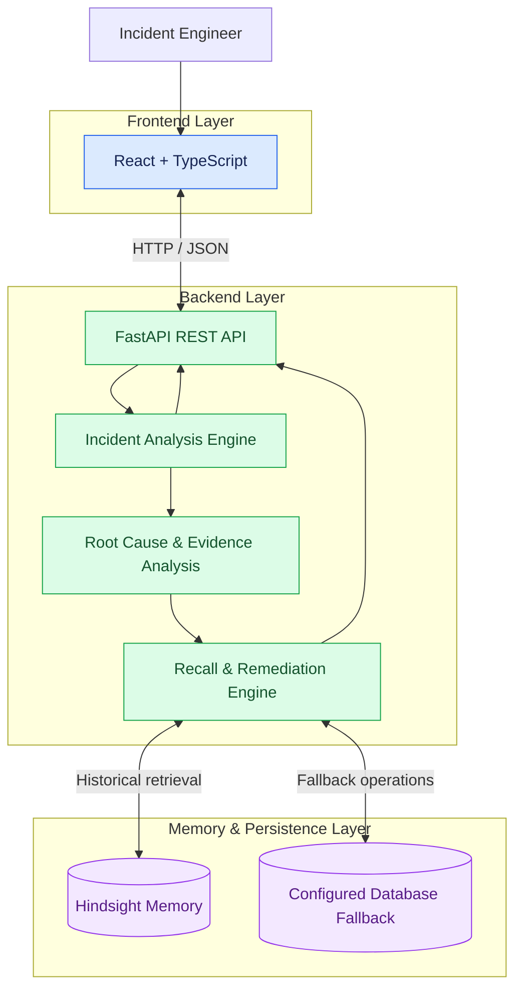
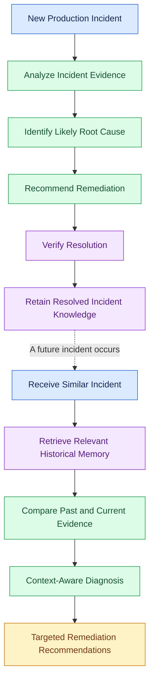

# AI Incident Intelligence Agent

**Persistent incident memory. Context-aware diagnosis. Actionable remediation.**

An AI-powered incident response system that analyzes production incidents, retains verified root causes and resolutions, and recalls relevant historical incidents to provide context-aware diagnoses and targeted remediation recommendations.

## Overview

Traditional incident-response workflows often require engineers to investigate recurring problems from scratch. This project explores how persistent memory can help an AI agent reuse knowledge from previously resolved incidents instead of treating every incident as an isolated event.

Built with **FastAPI, React, TypeScript, and Hindsight memory**, the system demonstrates an incident-analysis workflow that progresses from an initial diagnosis to verified resolution, memory retention, historical recall, and context-aware recommendations.

## Key Features

- **Incident Analysis** - Processes incident details and available diagnostic evidence.
- **Root Cause Identification** - Identifies likely causes based on the available evidence.
- **Persistent Incident Memory** - Retains verified root causes and resolutions for future investigations.
- **Historical Incident Recall** - Retrieves relevant past incidents when similar problems occur.
- **Context-Aware Recommendations** - Uses current evidence and recalled knowledge to recommend corrective actions.
- **Fallback Support** - Supports heuristic analysis and local database fallback behavior when optional services are unavailable.

## System Architecture



## Incident Memory Workflow

The central idea is to use verified knowledge from a resolved incident when a related issue appears again.



## Technology Stack

| Component | Technologies |
|---|---|
| Frontend | React, TypeScript |
| Backend | Python, FastAPI |
| Memory | Hindsight |
| Database / Fallback | PostgreSQL, SQLite fallback |
| API Communication | REST, HTTP, JSON |

## Verified Demo

The live cold-to-warm memory-recall verification demonstrated the following:

- The initial incident was analyzed without historical memory.
- The resolved incident's knowledge was retained.
- A subsequent related incident retrieved historical context with a reported **0.98 similarity score**.
- The recalled context supported diagnosis of a recurring payment API connection leak and database connection-pool exhaustion.
- The workflow verification script reported that all **8 steps** passed.

The similarity score represents the reported retrieval similarity in this demonstration, not a general measure of diagnostic accuracy.

## Getting Started

### Prerequisites

- Python and the project's backend dependencies
- Node.js and npm
- Git

### 1. Clone the Repository

```bash
git clone https://github.com/RohithaKavala/Nexora.git
cd Nexora
```

### 2. Start the Backend

From the project root, activate the existing backend virtual environment:

```powershell
.\backend\venv\Scripts\Activate.ps1
```

Start the FastAPI application:

```powershell
uvicorn backend.app.main:app --reload
```

### 3. Start the Frontend

Open a separate terminal:

```powershell
cd frontend
npm install
npm run dev
```

Open the local URL printed by Vite, typically:

`http://localhost:5173/`

Keep both terminal sessions running while using the application.

### Optional Service Configuration

Hindsight and an LLM provider require their respective services and configuration for live integrations. Check the project's configuration and environment variables before enabling them.

When optional services are unavailable, the application may use its configured fallback behavior. A successful fallback-based test does not by itself confirm that the external Hindsight service is connected.

## Project Goal

This project demonstrates how persistent memory can help an AI incident-response agent reuse verified incident knowledge, investigate recurring issues with historical context, and produce more relevant remediation recommendations.

It brings together API development, frontend integration, incident analysis, memory retrieval, and end-to-end workflow validation in a practical AI engineering project.
